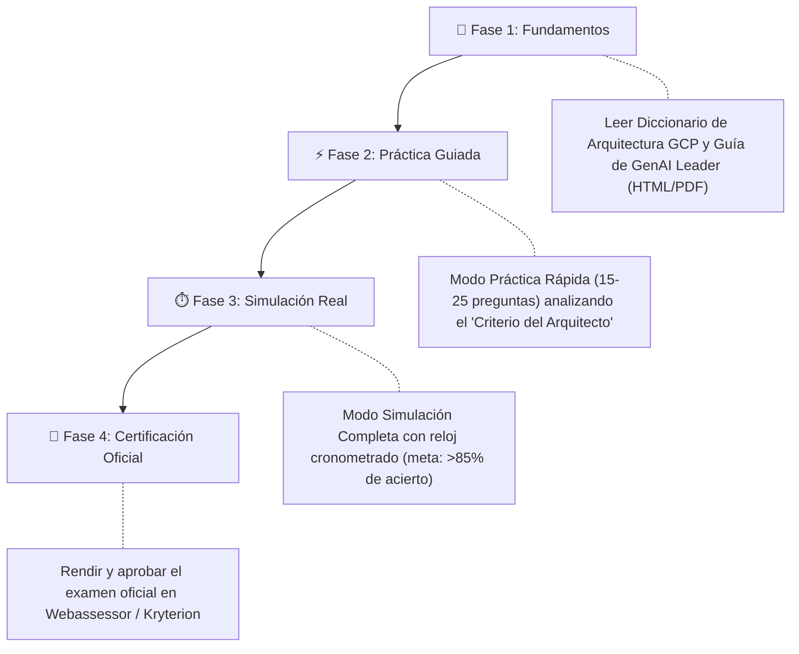

# 🚀 Google Cloud Certifications: Study Guides & Interactive Exam Simulators

Repositorio de preparación integral para dos de las certificaciones más demandadas del ecosistema Google Cloud:
1. **Google Cloud Professional Cloud Architect (PCA)**
2. **Google Cloud Generative AI Leader**

---

## 🎯 Propósito del Repositorio

El objetivo fundamental de este repositorio es **compartir abiertamente material de estudio de alto nivel, libre de barreras y 100% interactivo**, diseñado para que cualquier profesional de tecnología, arquitectura de software, datos o inteligencia artificial pueda preparar y aprobar exitosamente las certificaciones oficiales de Google Cloud.

### ¿Por qué nació este proyecto?
1. **Superar la brecha entre teoría y examen:** Muchos cursos oficiales se quedan en conceptos abstractos. Los exámenes reales de Google Cloud no evalúan memoria; evalúan **criterio de arquitecto**, trade-offs de costo/latencia, alta disponibilidad, seguridad y capacidad de resolver escenarios complejos.
2. **Simuladores 100% autocontenidos y offline:** Las plataformas comerciales de práctica suelen ser de pago mensual o requieren conexión constante. Los simuladores de este repositorio son archivos `.html` independientes: **basta con abrirlos con doble clic en cualquier navegador web moderno** (Chrome, Edge, Firefox, Safari) en PC, tablet o celular, sin necesidad de instalar Node.js, Python, bases de datos ni servidores web.
3. **Actualización continua con la tecnología real:** Incorpora las últimas novedades examinables de Google Cloud:
   - Modelos **Gemini 1.5 Pro & Flash**, modelos abiertos **Gemma** (ventajas de reproducibilidad y auditoría regulatoria en finanzas/salud mediante pesos congelados).
   - **Vertex AI Agent Builder** y orquestación híbrida con **Playbooks de Dialogflow CX** (combinación de flujos deterministas con LLMs y escalamiento humano SIP).
   - Arquitecturas **RAG de dos etapas** (Two-Stage Retrieval + Re-ranking), **Reasoning Engine**, destilación de modelos, VPC Service Controls, Private Service Connect y los casos de estudio vigentes de PCA.

---

## 📦 Contenido del Repositorio

| Archivo | Formato | Idioma | Contenido / Preguntas | Descripción |
| :--- | :---: | :---: | :---: | :--- |
| **`Simulador_Examen_GCP_Architect.html`** | HTML Interactivo | 🇬🇧 Inglés | **260 Preguntas** | Simulador de práctica para el examen **Professional Cloud Architect (PCA)**. Incluye los 4 casos de estudio actualizados, preguntas multi-selección, explicaciones técnicas completas y diseño adaptado a móviles. |
| **`Simulador_Examen_GenAI_Leader.html`** | HTML Interactivo | 🇪🇸 Español | **240 Preguntas** | Simulador de práctica para el examen **Generative AI Leader**. Cobertura profunda de LLMs, Vertex AI, RAG, agentes, gobernanza, seguridad y FinOps. |
| **`Diccionario_Arquitectura_GCP.html`** | Web / HTML | 🇪🇸 Español | **16 Módulos** | Guía de arquitectura completa de GCP con tablas comparativas, árboles de decisión, antipatrones de diseño y deep dives de infraestructura. |
| **`Diccionario_Arquitectura_GCP.pdf`** | Documento PDF | 🇪🇸 Español | 889 KB | Versión imprimible y de lectura offline del Diccionario de Arquitectura GCP. |
| **`Guia_Generative_AI_Leader_Google.html`** | Web / HTML | 🇪🇸 Español | **10 Módulos + Dives** | Guía teórica y estratégica de IA Generativa en Google Cloud (Transformers, Embeddings, Agentes, Prompt Engineering y Regulaciones). |
| **`Guia_Generative_AI_Leader_Google.pdf`** | Documento PDF | 🇪🇸 Español | 514 KB | Versión imprimible y de lectura offline de la Guía de Generative AI Leader. |

---

## 📺 Fuentes de Estudio, Videos y Playlists Utilizadas

> [!NOTE] 
> **Metodología de Transcripción y Creación de Casos:**  
> Todos los videos y listas de reproducción de YouTube enumerados a continuación fueron **transcritos íntegramente** (extrayendo las transcripciones y subtítulos completos tanto en español como en inglés). A partir de este material transcrito, se procesó la información para **uso general, estructuración de las guías teóricas y la creación de casos prácticos de arquitectura**, permitiendo capturar el razonamiento técnico real y los criterios de evaluación de cada instructor.

Para estructurar las guías teóricas y consolidar los bancos de más de **500 preguntas** con sus criterios arquitectónicos oficiales, se analizaron y sintetizaron materiales clave de la comunidad técnica y canales de referencia:

### 1. Canales y Listas de Reproducción de YouTube
- **AwesomeGCP (Sathish VJ):**
  - [Playlist: Google Cloud Professional Cloud Architect Exam Practice](https://www.youtube.com/playlist?list=PLQMsfKRZZviTIxEh0pkWNwnDUasGVZS4n)  
    *Análisis exhaustivo de preguntas de examen, desglose de opciones incorrectas y revisión de los casos de estudio oficiales (EHR Healthcare, Mountkirk Games, TerramEarth, Helicopter Racing League).*
  - [AwesomeGCP - Estrategia y Casos de Arquitectura](https://www.youtube.com/watch?v=UGt48Ekf8jg)
  - [AwesomeGCP - Desglose de Servicios y Selección Tecnológica](https://www.youtube.com/watch?v=u43gJJrVa1I)

- **CertifyDeck (En Español):**
  - [Playlist: Certificación Google Cloud Platform Architect](https://www.youtube.com/playlist?list=PLVudlB6z8U1Y)  
    *Fundamentos de servicios de GCP explicados en español, conceptos de redes híbridas, IAM, almacenamiento y compute.*
  - [CertifyDeck - Introducción y Fundamentos de Arquitectura Cloud](https://www.youtube.com/watch?v=pK-X-xRpppA)

- **GCP Practice Series (English Deep Dives):**
  - [Playlist: GCP Cloud Architect Exam Practice Walkthroughs](https://www.youtube.com/playlist?list=PLMp-_n0HEFXXu8kQPJU_gOUgYmp9DkuJx)  
    *Resolución paso a paso de preguntas tipo examen y mejores prácticas de Google.*
  - [Practice Walkthrough - Architectural Reasoning](https://www.youtube.com/watch?v=ws_C_VCV2vE)

### 2. Repositorios de Referencia de la Comunidad
- [ludovicobesana/gail-exam-preparation](https://github.com/ludovicobesana/gail-exam-preparation) — *Preparación para el examen Google Cloud Generative AI Leader, notas conceptuales y bancos de preguntas.*
- [sanda82/gcp-pca](https://github.com/sanda82/gcp-pca) — *Recopilación de notas, preguntas frecuentes y resúmenes para el Professional Cloud Architect.*

---

## 🕹️ Características de los Simuladores Interactivos

Los dos simuladores (`Simulador_Examen_GCP_Architect.html` y `Simulador_Examen_GenAI_Leader.html`) fueron desarrollados con foco en usabilidad y efectividad pedagógica:

```
┌────────────────────────────────────────────────────────────────────────┐
│                        MODOS DE EVALUACIÓN                             │
├───────────────────┬───────────────────┬────────────────────────────────┤
│ Modo              │ Preguntas         │ Tiempo / Enfoque               │
├───────────────────┼───────────────────┼────────────────────────────────┤
│ 🏆 Simulación     │ 60 PCA / 50 GenAI │ Con temporizador real          │
│ 🎯 Assessment     │ 30 PCA / 25 GenAI │ Evaluación rápida intermedia   │
│ ⚡ Práctica Rápida│ 15 PCA / 10 GenAI │ Estudio ágil con feedback      │
│ 📚 Maratón Total  │ 260 PCA / 240 GAIL│ Banco completo sin límite      │
└───────────────────┴───────────────────┴────────────────────────────────┘
```

### Funcionalidades Destacadas:
- **Criterio del Arquitecto:** Cada respuesta correcta incluye la justificación oficial de Google Cloud y el motivo por el cual las demás opciones no cumplen con los requerimientos (anti-patrones, sobrecosto o complejidad innecesaria).
- **Compatibilidad con Multi-selección:** Preguntas donde se solicitan 2 o 3 opciones aplican lógica estricta de validación con retroalimentación visual inmediata.
- **Temporizador con Pausa:** Permite practicar bajo la presión real del examen cronometrado o detener el reloj para profundizar en la explicación.
- **Marcador de Revisión ("Review Later"):** Marca preguntas dudosas para revisarlas antes de finalizar.
- **Diseño Táctil y Móvil:** Interfaz responsiva con botones adaptados a pantallas táctiles de celulares y tablets.
- **Estadísticas de Rendimiento:** Resumen final con porcentaje de acierto, desglose por dominios y recomendaciones de estudio.

---

## 🚀 Cómo Utilizar Este Material

### Opción A: Uso Local (Recomendado y 100% Offline)
1. Descarga el repositorio o clónalo en tu computadora:
   ```bash
   git clone https://github.com/MiguelLeivaLegua/ExamenesPCA-LiderIAGenerativa.git
   ```
2. Abre la carpeta descargada.
3. Haz **doble clic** sobre cualquier archivo `.html` para abrirlo en tu navegador favorito.
4. Para leer las guías sin conexión en tu tablet, e-reader o imprimir en papel, abre los archivos `.pdf`.

### Opción B: Práctica Online Directa vía GitHub Pages
Si deseas practicar desde cualquier dispositivo sin descargar nada:
1. Dirígete a la pestaña **Settings** > **Pages** de este repositorio en GitHub.
2. En **Build and deployment**, selecciona la rama `main` y la carpeta `/ (root)`.
3. Haz clic en **Save**. En 1 minuto tendrás una URL pública para acceder a los simuladores directamente desde tu navegador o celular.

---

## 🧭 Plan de Estudio Sugerido



1. **Semana 1-2:** Lectura exhaustiva de las guías teóricas (`Diccionario_Arquitectura_GCP` y `Guia_Generative_AI_Leader_Google`).
2. **Semana 3:** Práctica con los simuladores en modo sin tiempo, leyendo atentamente por qué cada distractor es incorrecto.
3. **Semana 4:** Ejecución de 3 a 5 simulaciones completas contra reloj en modo examen hasta promediar más del 85% de aciertos.

---

## 🤝 Contribuciones y Comunidad

Este repositorio es de código abierto con fines educativos. Si encuentras alguna actualización en los exámenes de Google Cloud, deseas reportar una errata o agregar nuevas preguntas basadas en tu experiencia en el examen, ¡los Pull Requests y las Issues son más que bienvenidos!

⭐ **¡Si este material te resulta útil para tu certificación, no dudes en dejarle una estrella al repositorio!**
